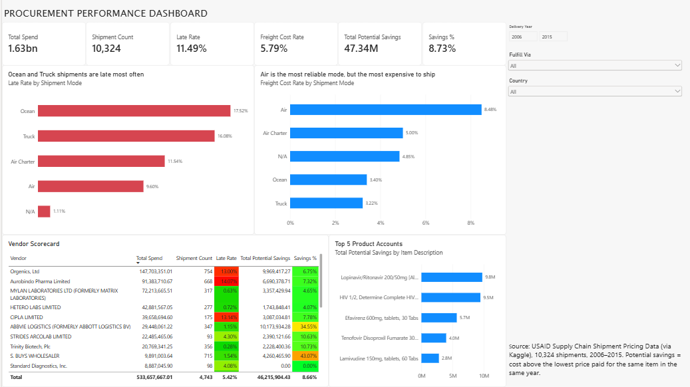
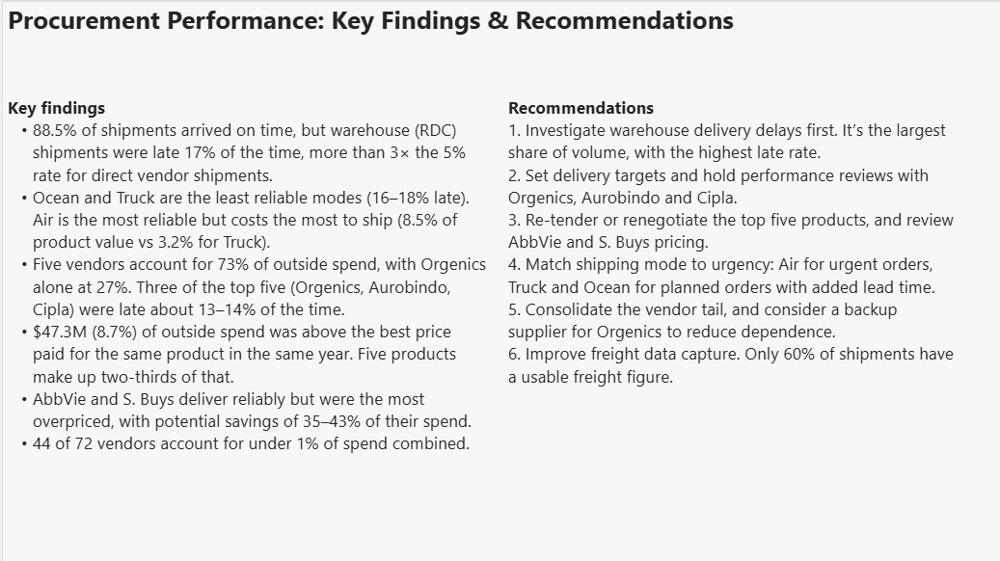

# Procurement Performance Analysis (Excel + Power BI)

An analysis of 10,324 health-commodity shipments to understand vendor performance, delivery reliability, freight costs and potential savings, built to support procurement decisions by budget managers and senior leadership.

## Business question
Which vendors and shipping methods deliver on time at the lowest cost, and where should procurement focus to improve value for money?

## Data
- **Source:** [USAID Supply Chain Shipment Pricing Data (Kaggle)](https://www.kaggle.com/datasets/divyeshardeshana/supply-chain-shipment-pricing-data)
- 10,324 shipments of HIV/AIDS medicines and test kits to ~40 countries, 2006–2015.
- Includes vendors, shipment mode, scheduled vs actual delivery dates, product value, unit prices and freight costs.
- Shipments are either sent **directly from vendors** (Direct Drop) or from a **regional distribution centre** (RDC warehouse).

## Key findings
- **Warehouse shipments are late 3× as often.** 88.5% of shipments arrived on time overall, but RDC shipments were late 17.2% of the time, against 5.3% for direct vendor shipments.
- **There's a trade-off between reliability and cost.** Ocean (17.5%) and Truck (16.1%) are late most often. Air is the most reliable main mode (9.6% late) but the most expensive to ship, with freight at 8.5% of product value against 3.2% for Truck.
- **Spend is highly concentrated.** Five vendors account for 73% of outside spend, and Orgenics alone for 27%. Three of the top five (Orgenics, Aurobindo, Cipla) were late about 13–14% of the time, against a 5% average.
- **$47.3M (8.7%) of outside spend was above the best price** paid for the same product in the same year. Five products account for about two-thirds of that.
- **Reliable doesn't mean good value.** AbbVie and S. Buys were rarely late, but potential savings equalled 35–43% of their spend.
- **There's a large vendor tail.** 44 of 72 vendors each account for under 0.1% of spend, under 1% combined.

## Recommendations
1. Investigate warehouse (RDC) delivery delays first. It's the largest share of volume, with the highest late rate.
2. Set delivery targets and hold performance reviews with Orgenics, Aurobindo and Cipla.
3. Re-tender or renegotiate the top five products, and review AbbVie and S. Buys pricing.
4. Match shipping mode to urgency: Air for urgent orders, Truck and Ocean for planned orders with added lead time.
5. Consolidate the vendor tail, and consider a backup supplier to reduce dependence on Orgenics.
6. Improve freight data capture. Only 60% of shipments have a usable freight figure.

## Approach
**Excel (data cleaning and analysis)**
- Converted the data into an Excel Table and added calculated columns: Days Late, Delivery Status, Late Flag, Freight Status, Freight USD and Freight % of Value.
- Cleaned the freight column, which mixed numbers with text such as "Freight Included in Commodity Cost", "Invoiced Separately" and "See ASN-…", by labelling each case and using only recorded freight values in cost analysis.
- Used pivot tables for delivery performance, freight cost, spend concentration and a vendor scorecard (vendors with 20+ orders).
- Estimated potential savings with `MINIFS`: the lowest price paid for the same item in the same year, excluding $0 (donated) orders.

**Power BI (dashboard)**
- DAX measures: Total Spend, Shipment Count, Late Rate, Freight Cost Rate, Total Potential Savings and Savings %.
- Used `CALCULATE` so freight cost rate is measured only against shipments with recorded freight, and savings only against outside vendor spend.
- Built an interactive overview page with slicers for year, country and fulfilment route, plus a one-page leadership summary.

## Analyst decisions
- **Total freight ÷ total value, not average percentages.** Small orders where shipping cost more than the goods (over 16,000% in one case) would otherwise distort the results.
- **The warehouse was analyzed separately from vendors.** "SCMS from RDC" is the organization's own warehouse (67% of spend), not a supplier.
- **Prices were compared within the same year**, because medicine prices fell over the period.

## Limitations
- Potential savings are an upper estimate. Price differences may reflect order size, urgency or contract terms, and a few unusually low one-off prices may overstate savings slightly.
- Freight analysis covers only the 60% of shipments with recorded freight costs.
- The data reflects one organization's donor-funded supply chain, so the figures show method rather than general benchmarks.

## Files
- `procurement_dashboard.pbix`: the interactive Power BI dashboard (open in Power BI Desktop)
- `procurement_analysis.xlsx`: Excel cleaning, pivot tables and savings analysis

## Tools
Excel (Tables, pivot tables, MINIFS, conditional formatting) · Power BI (Power Query, DAX)

## Author
Alizain Hirani · [LinkedIn](https://ca.linkedin.com/in/alizain-hirani-833969216)
